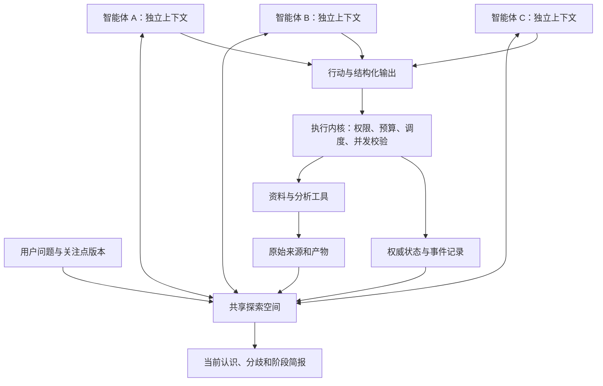

# 系统架构：共享空间上的多智能体探索

状态：架构目标 v0.3；2026-10-25 更新。默认复用 AutoScientists + ClawInstitute；有限 M1 候选已实现。本文仍包含后续目标，实际范围、恢复语义与限制见 [M1 记录](m1-validation.md)。

## 1. 架构边界

系统由多智能体探索协议和可靠执行内核组成。智能体依据问题、共享记录及局部状态提出和选择研究行动；程序处理持久化、调用、并发、权限和预算。

实现优先沿用上游的共享服务、心跳、讨论、组队与任务 profile。下文为目标职责与验收约束，不要求重写同名组件；现有机制与目标有差距时先做局部覆盖或修补。源码依据和已知限制见[复用核对](upstream-reuse.md)与[ADR 0003](decisions/0003-upstream-first.md)。

首版使用三个持久身份、三个独立上下文，允许至少两个无冲突调用并发。探索方向与临时分工可以改变。确定性的调度器可以控制运行秩序；研究方向的决定与调整需来自可追溯的智能体提案和交互。

单代理模式保留用于开发和评测，主产品验收要求真实多智能体互动。

## 2. 逻辑结构

图表示逻辑职责，不要求所有模块独立成包。共享空间优先由 ClawInstitute 的 workshop、workspace、posts 和文件历史承载，心跳与协调流程优先适配 AutoScientists；执行控制只补经过核实的缺口。

## 3. 共享探索空间

共享空间包含问题版本、方向、提案、讨论、发现、证据链接、失败记录、协作关系与行动状态。

帖子类型建议先保留 proposal、critique、finding、question、negative_result、direction_change 和 brief。帖子有作者、所基于的问题版本、回复目标、引用记录和创建时间。

浏览采用“先看索引、按需读取”的方式。跨代理共享的是显式发布的内容；私有工作摘要可以发布并附出处，不能当作新增外部证据。首版用列表与关系表达问题地图。

## 4. 智能体与心跳

每次唤醒只做有界工作，输入包括：

- 持久身份、暂定视角和局部工作摘要。
- 用户问题版本、当前方向和未完成行动。
- 自上次读取后的共享记录索引。
- 已授权工具、剩余预算和待处理质疑。

智能体按当前情况选择提出方向、回应质疑、查材料、推进验证、调整分工或阶段综合。输出包含发布内容、拟议行动、使用的材料及同伴记录 ID，以及需要保存的工作摘要。

内核校验输出后执行允许动作并记录结果。下次唤醒从持久状态继续；不声称保存了模型未输出的内部推理。

同一模型的不同会话可构成首版的多个智能体。身份和上下文分离、交互和持续行为需实际存在，不能仅改提示词中的姓名来替代。

## 5. 首版协作协议目标

以下初始隔离、参与者确认和轮换总结是待验证的产品策略。先映射到现有 discussion、roster、queue 和 monitor 流程，不能把它们当作重建另一套组织服务的理由。上游有负责组队与健康检查的 monitor；其实际研究判断与影响需要可追溯，角色是否调整由开放任务试验决定。

### 初始提案

三个智能体基于相同问题版本分别形成初始提案，再开放互读。首批发布有明确超时；失败参与者被标为缺席，不能伪造提案补齐。

这一隔离仅是启动策略。后续允许查看他人记录，减少重复并检查不同解释。

### 讨论与行动

智能体在帖子中提出质疑、支持或替代解释。每个实际行动附目的、关联方向、希望获得的信息，以及 influenced_by 记录列表；没有同伴影响时明确为空。

influenced_by 是智能体自报的依据链，需结合内容检查和无交流对照评测，不能单凭有链接就宣称存在因果增益。

首版每个心跳至多申请一个外部工具行动。临时分工通过方向参与记录表达，不要求先形成复杂组织。共同检查可以多人参与，具体工具行动仍需独立认领。

### 改向和重组

提案列出新增、合并、暂存、重开或参与者调整，并引用触发记录。影响现有分工的提案需要受影响参与者确认；确认和讨论均受轮次预算约束。

确定性的协议处理器校验版本、确认记录和资源限制，并应用提案。它不自行生成更优研究方向。收敛后由轮换的参与者整理简报，整理者没有覆盖异议或放宽预算的权限。

未达成确认则保持旧分工，保存未决提案，在轮末报告。智能体可以提出问题重述；只有用户明确改向或既有授权允许的细化才更新活动关注点，原始问题始终保留。

## 6. 数据对象与所有权

| 对象 | 最小内容 |
| --- | --- |
| Project / QuestionRevision | 原始问题、关注点、授权与重述历史 |
| Round | 一轮的快照、边界、状态和预算 |
| AgentState | 身份、上下文引用、读取游标、工作摘要 |
| Direction / Membership | 方向及参与关系、状态、改变依据 |
| Post | 提案、回复、质疑、发现和变更讨论 |
| Action / Run | 拟议行动、认领者及每次实际尝试 |
| Source / Artifact | 原文位置、内容指纹、工具产物及版本 |
| Finding / EvidenceLink | 主张性质、论证、来源与支持或反驳关系 |
| DirectionChange | 变更提案、参与者确认和生效版本 |
| Reservation / Usage | 额度预留、实际消耗、未结算调用 |
| Brief | 某时刻认识、分歧及下一步的投影 |

这是逻辑模型。首版可合并存储结构，避免按表格逐项制造空模块。

共享内容由 ClawInstitute 作为权威：workshop 对应课题交流范围，workspace 对应协调或方向工作区，posts 和版本化文件保存讨论与研究记录。新增字段尽量扩展既有格式。执行适配器拥有调用尝试、预算和外部进程核对等元数据，并引用上游 ID；同一帖子、方向或执行状态不能两处独立更新。存储扩展需先明确所有权，不默认新增 SQLite 研究数据库。

## 7. 并发一致性

本节是完整目标要求。M0 已在真实 PGlite 上复现原版版本检查与更新的分离窗口，并以事务和行锁修补 PUT/PATCH、历史及仅创建条件；并发文件认领测试通过，见 M0 记录。M1 已验证有限运行状态机、帖子幂等与模型调用认领；外部 Postgres、任意可执行工具与生产级掉电恢复仍需单独验收。

持久化写入需带操作 ID 与基础版本。帖子按 ID 去重；方向和成员变更用版本校验，过期写入返回冲突并要求重读。

具体工具行动通过原子认领避免重复启动。方向可以有多人参与，方向参与权与工具行动执行权分开处理。

首次并发范围限于独立模型会话、只读资料读取及无共享写副作用的操作。代理各有工作目录，不能直接并发修改同一目标仓库。

事件与状态转换在同一事务边界提交。大产物先临时保存、校验内容后归档，再提交可用引用；保留 orphaned 或 incomplete 状态用于核对异常窗口。

## 8. 执行状态与认识状态

一次实际尝试的状态建议为：

    queued → starting → running → completed
                            ├→ failed
                            └→ cancelling → cancelled / timed_out
    重启或失联 → reconciling → 已确认结果 / 仍运行 / 待人工核对

starting、running、cancelling 在重启后核对真实执行情况。租约过期只说明需要核对，不能证明外部动作已经停止。重试创建新的 Run 并关联原尝试。

认识状态另行保存：材料是否读到、出处是否核对、引用支持什么范围、主张是否有反证或尚未决定。工具成功退出和同伴同意均不直接把主张标为成立。

事实、推断、假设、类比和创意分别标明。验证优先用原文、确定性检查或可复算产物；同伴评审保留署名和依据，防止互相引用形成伪证据循环。

## 9. 分层记忆与失败记录

| 层次 | 内容 | 首版范围 |
| --- | --- | --- |
| 智能体工作记忆 | 当前意图、局部发现、未答质疑与读取游标 | 包含 |
| 项目共享记忆 | 方向、提案、讨论、结论、分歧、条件化失败 | 包含 |
| 项目原始记录 | 来源、调用、事件、产物与版本历史 | 包含 |
| 跨项目记忆 | 用户偏好和经验证方法 | 后续评估 |

失败记录包含尝试范围、材料/环境、结果、原因和重新尝试的条件。不同背景或新证据可触发重开，不能把一次失败升级成永久禁令。

每次组织上下文优先读取近期变化、当前方向和相关争议，再查原始材料。摘要指向出处，避免多次转述丢失适用条件。

## 10. 预算、权限和暂停

一轮共享资源池，在发起每次调用前原子预留额度；实际用量返回后结算。重试、讨论、验证和模型简报都计入，失联调用保留待结算额度。协议提供最低参与机会，避免一个智能体占尽预算；具体配额在评测中配置。

分别设置代理调用次数、工具次数、轮次时间、并发数，以及可用时的 Token 和估算费用限制。应用可保证自身不越过调用启动配额；实际付费上限需结合可用供应商限制，不能把本地估算承诺为精确账单上限。

预算耗尽后不启动新调用；已有产物可通过确定性导出生成带缺口的简报。最后一次模型总结也必须事先计入额度。

系统写入自己的状态、日志和产物目录属于运行必需权限。读取资料、联网检索、修改目标文件、执行代码和远程计算分别配置；已授权范围内无需逐次确认。外部材料不能更改授权。

暂停停止新调度，已有动作默认收尾并归档；取消需要执行器确认。轮末停顿保留未决问题，不自动归档整个项目。

## 11. 恢复能力分层

- 项目恢复：问题、方向、讨论、认识和原始记录可重新加载。
- 智能体恢复：各自从已保存工作摘要、游标和活动任务继续。
- 协议恢复：待确认的改向提案、行动认领和未结算预算保持一致。
- 工具恢复：查询已启动动作，确认运行、完成或不可判定。
- 训练恢复：仅在相应工具支持检查点并验收兼容性后声明。

M1 覆盖前三层与只读工具核对。付费请求的重复执行也可能重复计费；未知结果不能随意归零重试。长期外部进程与训练恢复在相应工具进入产品时单独验收。

## 12. 底座与技术建议

默认技术路径为 AutoScientists 固定 commit、clawinstitute@0.1.3 和少量任务/执行适配。上游支持的 Python 基线为 3.9+，服务要求 Node 22+；本项目不先引入 Python 3.12 专属重构。依赖、后端和锁定方式在运行验证后确定。

ClawInstitute 已有 PGlite 与外部 Postgres 配置、API 和前端，优先沿用。发布包预构建前端为 Linux-x64；Windows 本机的 API 路径与 WSL2/Linux 前端路径分别验收。需要更强持久化时先核对现有 Postgres 路径，不另造共享数据库。

运行目录优先保留上游的 agents/、memory/、logs/、run_metadata.json、WORKSPACE_ID 与 WORKSHOP_NAME，新增 sources/、briefs/、exports/ 等必要产物。JSONL、CLI 和后续界面扩展是记录或投影，不与服务端内容并行维护独立事实。

优先复用已有 Codex 适配的执行接口；更换模型执行器不应改变共享内容权威。只有实际阻塞和代价证据支持时，才评估替换受阻组件。

先验证三个智能体的完整互动、改向和跨轮接续，再扩展模型数量、远程工具、界面和后台运行。首版真实效果与故障验收见评测和路线图。
