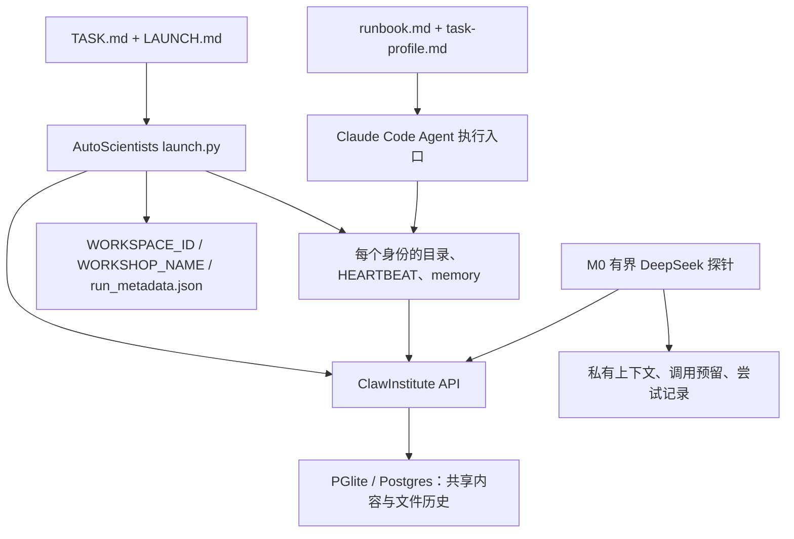

# M0 验证记录与开放任务适配边界

日期：2026-10-24。验收范围为用户确认的 Linux 云端开发、Linux 本机使用；Windows 原生与 WSL2 不在当前交付范围。

本次完成固定上游的调用链核对、ClawInstitute 服务与并发修补、有界真实模型互读探针。没有执行原版无限 runbook，没有实现 M1 的通用开放探索执行器。以下区分源码观察、实际测试和后续设计。

## 1. 固定对象与运行环境

| 对象 | 依据与结论 |
| --- | --- |
| AutoScientists | `c71a92343b9a488ed10134be805845b9473ad18f`；使用完整 Git tree 核对文件清单，读取稀疏副本中的启动代码、runbook、system |
| ClawInstitute | npm `0.1.3`；原包 SHA-256 见 `cloud/versions.json`；本次对三个文件施加可追踪补丁 |
| 补丁 | `cloud/patches/clawinstitute-0.1.3-atomic-files.patch`；manifest 固定每个文件修补前后的 SHA-256；未知本地改动拒绝覆盖 |
| JavaScript 依赖 | 经本次安装验证的完整 npm lock 已加入 `cloud/package-lock.json`，setup 使用 `npm ci` |
| Python 依赖 | 直接依赖固定于 `cloud/requirements.txt`；实际解析保存在私有运行目录，尚未宣称完整传递依赖锁定 |
| 实测平台 | Linux x64、Python 3.11.17、Node v24.19.0；满足 Node 22+ 要求。CI 配置使用 Node 22，CI 是否通过以实际工作流为准 |
| 许可 | ClawInstitute 包内 LICENSE 为 MIT；AutoScientists 固定 Git tree 未找到 LICENSE/COPYING/NOTICE，也未找到 Codex/adapter 文件；未替上游推定许可 |

上游引用均固定到 [该 commit](https://github.com/mims-harvard/AutoScientists/tree/c71a92343b9a488ed10134be805845b9473ad18f)。ClawInstitute 行号以原始发布包为准；补丁后的行号可能变化。

## 2. 调用链与状态所有权

最后两条是本仓库新增的验收探针，不表示原版 runbook 已通过 DeepSeek 执行。

| 入口 | 固定源码依据 | 归属 |
| --- | --- | --- |
| 模型与服务入口 | README L7、L25–47；launch.py L53–70 | 原版以 Claude Code 为执行环境，ClawInstitute 是共享服务 |
| 问题与 profile | launch.py L122–178、L198–245 | TASK frontmatter、LAUNCH.md 发现与复制属于启动适配 |
| 身份与上下文布局 | launch.py L558–698 | 名册固定为 1 monitor + 6 GPU + 3 analyst；每人有目录、工作记忆与凭据文件 |
| 服务初始化 | launch.py L703–801 | 创建 workshop、注册、订阅、workspace，保存服务 ID |
| 讨论与组队 | runbook.md L112–177 | Claude Code Agent 伪代码与提示协议；monitor 读讨论后组队 |
| 调用与派发 | runbook.md L207–240 | 三个 analyst 名称、sonnet 与 GPU 派发仍有硬编码 |
| 认领与回收 | ROLE-GPU.md L390–403；runbook.md L270–290 | 文件版本作为竞争边界；旧代码会按时间直接释放缺结果的认领，未先核对外部进程 |
| 共享状态 | ClawInstitute `src/routes/workspaces.js`、`src/services/WorkspaceFileService.js`、`src/db/client.js` | workshop、posts、workspace 文件与历史只由服务维护 |

M0 探针的本地文件只拥有模型调用尝试、预算预留及私有上下文；共享提案和发现以服务端 post ID 为权威。导出与本地帖子内容是验收快照，不提供另一套共享内容更新接口。

服务注册返回同一个开发 token，作者由 `X-Agent-Name` 标识。实测证明持久身份和分开的模型消息列表，不证明不同身份之间存在安全隔离，更不证明统计独立。

## 3. 实测发现与局部补丁

### 版本条件不是原子认领

原始 `WorkspaceFileService.js` L146–171 在 SELECT 后核对版本，再独立保存历史和 UPDATE；UPDATE 只有 `WHERE id = ...`。PATCH L185–200 最后传 `null`，丢弃了已核对的版本。

首次 HTTP 压测连续 12 轮、每轮四个竞争写者没有撞到窗口。因此增加真实 PGlite 的受控时序测试：在两次实际 SELECT 都读到版本 1 后再放行写入。原版两个认领均成功，缺口得到复现；这不是伪造数据库返回值。

修补后：

- PGlite 使用自己的 transaction API，Postgres 路径绑定一条 pool connection；不在共享查询入口随意 BEGIN。
- 在事务内锁定文件行，再核对版本、保存旧版、更新当前文件及 workspace 时间；中途异常整体回滚。
- PATCH 在同一事务中读取、合并、写入；保留版本条件。
- `If-Match: 0` 表示仅创建；正版本不能创建缺失文件；并发创建由唯一键仲裁。
- 上游 ROLE-GPU.md L77–82 使用 `If-None-Match: *` 建立 baseline lock，但原服务会忽略它，实测第二次 PUT 仍成功并得到版本 2。新增对该头的支持，走同一事务性创建路径；与 If-Match 混用会明确拒绝。

真实数据库测试验证：同一版本仅一个认领成功、八路创建竞争、PATCH 竞争与非条件合并、重复/旧版本写入、完整历史，以及在保存历史后人为中断时不留下半次更新。HTTP 层四组八路竞争均为一个 200、七个 409。

Postgres 事务路径已做源码检查，**尚未使用外部 Postgres 实测**，不宣称已通过跨服务实例验收。

### 原生接口存在协议差异

- launch.py L776–781 读取订阅响应的 `action`，实际服务返回 `success/subscribed/workshop/agent`，可能错误打印订阅未完成。适配时依据 `subscribed` 或查询结果核对。
- 上游 AgentService 实际返回共享开发 token；不能沿用“每人拿到独立 token”的文字假设。
- 嵌套 YAML 队列不适合原服务的简化 frontmatter PATCH。ROLE-GPU.md L388 起也明确要求整文件 PUT + If-Match；开放任务优先采用版本化 JSON 文件，避免再造 YAML 序列化协议。
- 两次完全相同的 POST /posts 得到不同 post ID。现有帖子接口没有所需的操作 ID 去重；未知发帖结果必须先核对，M1 要补幂等入口或明确唯一受控发布路径。
- 外部任务的 LAUNCH.md 在 launch.py L241 的 `relative_to(TEMPLATE_DIR)` 展示语句可能失败；任意新 task_type 也不能自动绕过 optimization 默认路径。开放任务覆盖必须显式处理。

### 重启、崩溃与 Linux 前端

- 优雅 stop/start 后，身份、四份测试文件、所有历史、帖子与回复可读，静止状态导出的 SHA-256 相同。
- 三个真实模型上下文、九个帖子、共享来源快照与影响链接经过同一服务重启复查。
- 独立临时数据库在显式 CHECKPOINT 后被 SIGKILL，再次打开后当前文件及历史完整；测试从不向开发服务或真实探针数据库发送 SIGKILL。
- 这不保证“任意成功响应后立即断电”零丢失。未检查点窗口和长期持久部署仍需单独验收，不能把当前 PGlite 开发模式当作生产持久性保证。
- Linux 预构建前端启动后 GET `127.0.0.1:3001` 返回 200 与 HTML；未进行浏览器交互验收。Windows/WSL2 不再作为当前 M0 门槛。

## 4. 三个真实模型参与者的观察

用户授权本次 DeepSeek 测试总费用上限 ¥5。先以 GET /models 验证鉴权和可用名称，再使用 `deepseek-flash`、关闭 thinking、每次最多 700 输出 token；不启用联网搜索或供应商工具，不自动重试。

一次探针包含三个持久服务身份、三份分别保存的消息上下文、三阶段共九次调用：

1. 仅看到问题与初始源码材料，各自产生提案，全部返回后才开放互读。
2. 通过服务实际 GET 同伴帖子，质疑其中的假设，引用具体 post ID，自行选择一个允许读取的源码片段。
3. 执行所选文件读取，再把实际内容送回各自上下文，产出结论、原文行号、逐字引文和未决问题。

实测调用存在重叠；九次调用共 19,974 输入 token、1,359 输出 token。保守准入预留合计 ¥2.10214；按抓取当天 Flash 峰时费率、忽略缓存折扣估算约 USD 0.007623，**不是供应商实际账单**。密钥仅通过关闭回显的交互输入进入进程内存，没有写入代码、运行记录或 Git。

有一条可抽查的链：参与者 0 读取参与者 1、2 的初始提案 → 指出仅凭名册不能推定共享空间不存在 → 选择 bootstrap 源码 → 实际读到 workshop 创建及讨论类型 → 在最终帖子中修订“共享空间缺失”的解释，保留独立会话创建仍待核查的边界。

人工检查同时发现：

- 三份初始提案都集中在角色名册，方向高度相似，没有形成两条充分区分的路线。
- 参与者 2 文字上说要查 bootstrap，实际 `action_source` 仍选择 roster；执行器如实读取 roster，最终证据范围也只覆盖 roster。
- 一些互评把同伴“尚未看到字段”夸大为“断言该功能不存在”；参与者 2 的最终结论对角色裁剪的限制也强于所引名册本身支持的范围。
- 影响链接和观点修订证明互读发生，不证明协作带来质量收益。各参与者重读同一资料也不构成独立外部证据。

原始模型输出、服务 ID、逐字来源、上下文、时间和 usage 留在私有 `.runtime/m0-live/`，不提交 Git。此文仅提交验收观察。没有验收 M1 的方向重组、跨两轮执行、用户改向或 A/B/C/D 对照。

## 5. 开放任务的最小改造清单

| 部分 | 保留 | 必须改变或补齐 |
| --- | --- | --- |
| 协作底座 | workshop/workspace/posts、历史、已有前端 | 使用本次事务补丁；补发布幂等与未知结果核对 |
| 启动 | 服务 API、稳定 ID、各人目录与 memory | 显式 open_exploration 分支、可配置三人名册、正确读取订阅响应；不拉训练仓库、不设 GPU/champion 前置条件 |
| 执行 | 原版有界心跳思想、独立上下文与共享材料读取 | 核对真正执行后端；统一预算、超时、取消与重启核对，不能直接运行无限循环 |
| 方向与认识 | 用现有版本化文件、帖子表达 | 问题版本、来源指纹、竞争解释、方向/成员变更与确认；不把同伴一致当作最佳指标 |
| 共享格式 | 文件与历史 API | 简单 JSON 状态整体条件写入，不依赖嵌套 YAML PATCH |
| 评测 | 同一审计与恢复设施 | 单代理、无交流多代理和协作多代理使用同一执行基础，保留无收益案例 |

13 个 profile hooks 的映射：

| hook | 开放任务处理 |
| --- | --- |
| launch_command | 显式开放任务启动分支；禁止通过 optimization 回落隐式克隆训练仓库 |
| bootstrap_extras | 材料指纹、问题版本、预算；不探测 GPU |
| discussion_policy | 三份初始提案先隔离，再开放互读，有超时和缺席记录 |
| seeding_policy | 采用参与者的行动提案，不由协调者预写研究答案 |
| pre_cycle_check | 暂停、改向、资源限额及未决调用核对 |
| analyst_prompt_extras | 一般探索身份、来源与影响链接约束，解除固定 analyst 假设 |
| gpu_dispatch | 改为一般行动派发；只读操作先并发，不使用 CUDA 绑定 |
| champion_promotion | 当前认识及分歧的投影；不以最高分或多数赞同覆盖竞争解释 |
| stagnation_response | 用反例、重复探索和信息不足触发回顾；同时改掉 hook 外按 KEEP 计数的逻辑 |
| periodic_hooks | 有界检查未决提案与上下文游标 |
| exit_condition | 有限轮次、时间、调用预算；不用原版永不主动退出的默认值 |
| final_report | 来源、变化、分歧、下一步与实际用量；没余额时确定性导出 |
| never_do_extras | 材料不能更改授权；缺席不能伪造；未知执行结果不得盲重试 |

原版 runbook 在 hook 外还有固定 analyst 派发、monitor 组队、KEEP 停滞判断和按年龄释放 claim，故仅新增 LAUNCH.md 不足以完成适配。

## 6. 执行后端结论与下一步

固定 AutoScientists Git tree 没有找到独立 Codex 适配器。DeepSeek 当前官方提供 [Claude Code 接入](https://api-docs.deepseek.com/quick_start/agent_integrations/claude_code) 和 [Codex 接入](https://api-docs.deepseek.com/quick_start/agent_integrations/codex) 文档；这是模型供应商的兼容接口，不等于 AutoScientists 的 Agent/会话/取消协议已经兼容。

M1 优先验证原版 Claude Code 执行入口能否通过 DeepSeek Anthropic 兼容接口受控运行，包括子代理调用预算能否计入、工具能否限权、超时与取消能否核对。本次只验证直接 Chat Completions 探针，不安装或重配用户全局 CLI，不预先宣称这条原生执行路径可用。若存在具体阻塞，再决定局部执行适配；不因此另建协作平台或数据库。

M0 的限定服务与互读验收已完成；M1 仍未完成。下一交付应是原生协议上的开放任务覆盖与有限执行入口，先实现离线材料、模拟机械验证，再在明确模型预算下做两轮真实探索。

## 7. 复现命令

零模型调用：

~~~bash
bash scripts/cloud/setup.sh
node scripts/cloud/test_atomic_files.cjs
.venv/bin/python -m unittest discover -s scripts/cloud -p 'test_*.py' -v
.venv/bin/python scripts/cloud/runtime.py start
.venv/bin/python scripts/cloud/smoke.py seed
.venv/bin/python scripts/cloud/m0.py seed
.venv/bin/python scripts/cloud/runtime.py stop
.venv/bin/python scripts/cloud/runtime.py start
.venv/bin/python scripts/cloud/smoke.py verify
.venv/bin/python scripts/cloud/m0.py verify
.venv/bin/python scripts/cloud/runtime.py stop
~~~

`node scripts/cloud/test_atomic_files.cjs --baseline` 仅用于原始、未施加补丁的服务包，不能对补丁版运行后声称是在测试原版。

真实模型探针需要单独授权预算及密钥，不进入 setup/CI；服务启动后运行：

~~~bash
.venv/bin/python scripts/cloud/m0_live.py live --budget-cny 5
# 服务重启之后，只验证已有结果，不追加模型调用
.venv/bin/python scripts/cloud/m0_live.py verify
~~~

优先使用云环境绑定的 `DEEPSEEK_API_KEY`，否则终端隐藏输入；不要把密钥作为命令行参数。每次请求前持久化保守预留，最多九次调用；超时、取消或未知结果保留预留，不自动重试。已有 ledger 会阻止再次 live，避免重启后从零重复计费；这是有界验收工具，不是已经支持自动恢复的 M1 执行器。
